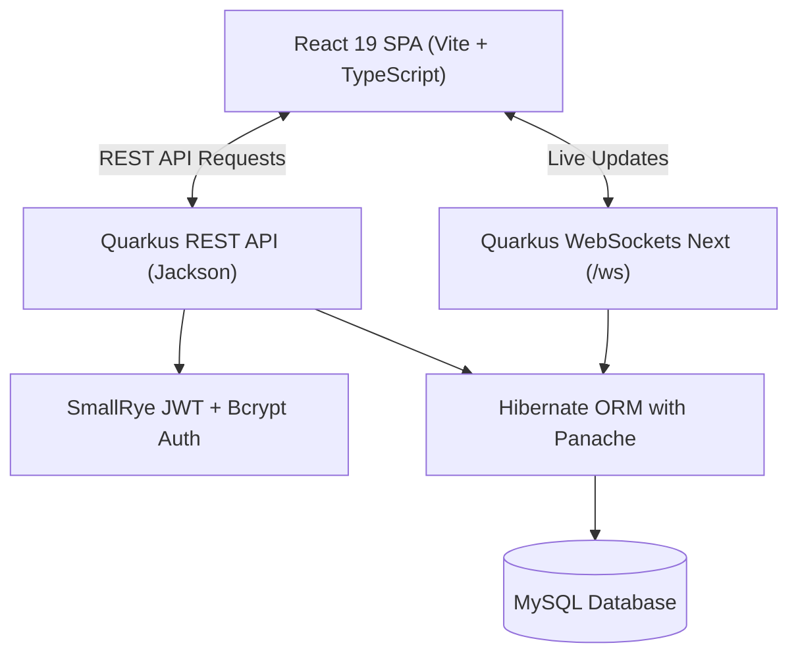

# ResMana — Smart Restaurant Management Platform

<p align="center">
  
</p>

<p align="center">
  <b>A modern, realtime full-stack restaurant management system built with Java Quarkus, React 19, and Tailwind CSS.</b>
</p>

<p align="center">
  
  
  
  
  
  
  
  
</p>

---

## 📖 Overview

**ResMana** is an all-in-one restaurant operations platform designed to eliminate daily operational chaos. It connects table seating, kitchen order ticketing, menu catalogs, staff permissions, and payments into a single, cohesive realtime interface.

### ✨ Key Features

- **🗺️ Interactive Table Map (Sơ đồ bàn)**:
  - Visual grid showing realtime table statuses: `Available`, `Occupied`, `Reserved`, and `Maintenance`.
  - Add, edit, or delete tables with capacity and location tags (e.g., *Indoor, Outdoor, VIP*).
- **⚡ Realtime Kitchen & Order Synchronization**:
  - Powered by Quarkus Next-Generation WebSockets (`/ws/restaurant/{restaurantId}`).
  - Table orders update live across cashier, floor staff, and kitchen devices with zero manual page refreshes.
- **💳 Multi-Channel Payment System**:
  - **VietQR Transfer**: Dynamic client-side QR generation via VietQR with pre-filled amount, bank account info, and table reference.
  - **POS Card Terminal**: Guided 3-step workflow for chip, contactless, or swipe credit/debit card transactions.
- **📄 Instant PDF Receipts**:
  - Clean client-side receipt generation (`jsPDF`) with item breakdown, pricing, VAT, and custom restaurant branding.
- **🍽️ Dynamic Menu Management**:
  - Categorized dishes (*Appetizers, Mains, Drinks, Desserts*) with realtime availability toggles.
- **👥 Role-Based Access Control (RBAC)**:
  - Fine-grained staff permission hierarchy (`Chủ cửa hàng`, `Quản lý`, `Phục vụ`, `Thu ngân`, `Bếp`).
  - Strict privilege escalation protection (staff cannot assign Owner roles or edit higher-ranking peers).
- **📊 Business Analytics & Reporting**:
  - Comprehensive revenue dashboards, order frequencies, average ticket size, and top-selling dishes.
- **🏢 Multi-Tenant Workspace**:
  - Single phone number login supports owning or working across multiple restaurants with instant workspace switching.

---

## 🎨 Design System & Palette

ResMana uses a warm, nature-inspired palette engineered for restaurant environments:

| Token | Hex | Role |
| :--- | :--- | :--- |
| **Garden** | `#C7F4A4` | Primary brand accent, highlights, CTA badges |
| **Midnight** | `#202923` | Primary text, deep dark containers, sidebar ink |
| **Porcelain** | `#F7F8F5` | Neutral app background, card surface |
| **Forest** | `#52735B` | Interactive hover states, active badges, icons |
| **Typography** | `Manrope` | Modern, clean geometric sans-serif |

---

## 🏗️ Architecture & Tech Stack



### Backend
- **Framework**: [Quarkus 3.34](https://quarkus.io/) (Java 21)
- **Persistence**: Hibernate ORM with Panache, MySQL JDBC Driver
- **Security**: SmallRye JWT (RSA Private/Public key pair), Bcrypt password hashing (12 rounds)
- **Realtime**: `quarkus-websockets-next`
- **Validation**: Hibernate Validator (JSR 380)
- **Testing**: JUnit 5, Surefire

### Frontend
- **Framework**: [React 19](https://react.dev/) + [Vite 8](https://vite.dev/) + [TypeScript](https://www.typescriptlang.org/)
- **Styling**: [Tailwind CSS v4](https://tailwindcss.com/)
- **Icons**: [Lucide React](https://lucide.dev/)
- **PDF Export**: [jsPDF](https://github.com/parallax/jsPDF)
- **Charts**: [Recharts](https://recharts.org/)
- **Testing**: Node.js Built-in Test Runner (`node:test`, `node:assert`)

---

## 📁 Project Structure

```text
QuanLyNhaHang/
├── backend/
│   ├── src/main/java/web/com/
│   │   ├── controller/      # REST API endpoints (Auth, Table, Order, Menu, Staff, Report)
│   │   ├── model/           # Panache entities (Account, Restaurant, Membership, TableEntity, Order, OrderItem, MenuItem)
│   │   ├── security/        # JWT TokenService, Roles RBAC, TenantContext
│   │   ├── websocket/       # RestaurantWebSocket & WebSocketBroadcaster
│   │   └── exception/       # ErrorResponse & ValidationExceptionMapper
│   ├── src/main/resources/
│   │   ├── application.properties # Datasource, CORS, and JWT configuration
│   │   ├── import.sql             # Development seed data
│   │   ├── PrivateKey.pem         # RSA private key for JWT signing
│   │   └── publicKey.pem          # RSA public key for JWT validation
│   ├── src/test/java/       # Comprehensive JUnit 5 test suite
│   ├── pom.xml              # Maven dependencies & plugins
│   └── mvnw                 # Maven wrapper
│
├── frontend/
│   └── restaurantManagement/
│       ├── public/          # Brand logos, icons, fonts
│       ├── src/
│       │   ├── api/         # Axios/Fetch clients, auth session, websocket hook
│       │   ├── components/  # Reusable UI (Logo, Dropdown, Buttons)
│       │   ├── layout/      # MainLayout, Sidebar, ProtectedRoute, AuthGuard
│       │   ├── pages/       # Dashboard, Landing, Onboarding, Menu, Staff, Reports, etc.
│       │   ├── types/       # TypeScript models
│       │   ├── App.tsx      # Client router configuration
│       │   └── marketing.css# Landing & Onboarding custom styling
│       ├── test/            # Node.js unit test suites
│       ├── package.json     # Node scripts & dependencies
│       └── vite.config.ts   # Vite configuration with proxy rules
│
└── README.md
```

---

## 🚀 Getting Started

### 1. Prerequisites
- **Java**: OpenJDK 21 or higher
- **Node.js**: v20.x or higher (tested on v25)
- **Database**: MySQL 8.0+ running on `localhost:3306`

### 2. Database Setup
Create a new database in MySQL:
```sql
CREATE DATABASE restaurant_db CHARACTER SET utf8mb4 COLLATE utf8mb4_unicode_ci;
```

*(Optional)* Configure database credentials via environment variables or edit `backend/src/main/resources/application.properties`:
```properties
quarkus.datasource.username=root
quarkus.datasource.password=your_password
quarkus.datasource.jdbc.url=jdbc:mysql://localhost:3306/restaurant_db
```

### 3. Start Backend
```bash
cd backend
./mvnw quarkus:dev
```
- REST API runs at: `http://localhost:8080`
- Quarkus Dev UI: `http://localhost:8080/q/dev/`
- Seed data (`import.sql`) runs automatically on startup.

### 4. Start Frontend
```bash
cd frontend/restaurantManagement
npm install
npm run dev
```
- Web Application: `http://localhost:5173`

---

## 🔑 Default Test Credentials

The backend comes pre-seeded with sample restaurant data (`import.sql`):

| Role | Phone Number | Password | Assigned Restaurant |
| :--- | :--- | :--- | :--- |
| **Chủ cửa hàng (Owner)** | `0901234567` | `Abcd1234` | Quán Ngon ResMana |

---

## 📡 REST API & WebSocket Reference

### Authentication (`/api/auth`)
| Method | Endpoint | Description | Access |
| :--- | :--- | :--- | :--- |
| `POST` | `/api/auth/register` | Register a new account | Public |
| `POST` | `/api/auth/login` | Authenticate with phone & password | Public |
| `POST` | `/api/auth/select-restaurant` | Issue restaurant-scoped JWT | Authenticated |

### Table Management (`/api/tables`)
| Method | Endpoint | Description | Access |
| :--- | :--- | :--- | :--- |
| `GET` | `/api/tables` | List all tables for current restaurant | Staff |
| `POST` | `/api/tables` | Create a new table | Manager, Owner |
| `PATCH`| `/api/tables/{id}/status` | Update table status (`AVAILABLE`, `OCCUPIED`, etc.) | Staff |
| `DELETE`| `/api/tables/{id}` | Delete a table | Manager, Owner |

### Orders & Billing (`/api/orders`)
| Method | Endpoint | Description | Access |
| :--- | :--- | :--- | :--- |
| `GET` | `/api/orders?status=PENDING` | List open orders | Staff |
| `POST` | `/api/orders` | Create a new table order | Staff |
| `POST` | `/api/orders/{id}/items` | Add dishes to an existing order | Staff |
| `PUT` | `/api/orders/{id}/pay` | Settle payment and close order | Staff |

### Realtime WebSocket Endpoint
```text
ws://localhost:8080/ws/restaurant/{restaurantId}
```
**Broadcast Event Types**:
- `ORDER_CREATED`: New kitchen ticket submitted.
- `ORDER_UPDATED`: Items added to active table.
- `ORDER_PAID`: Bill cleared by customer.
- `TABLE_CREATED` / `TABLE_UPDATED` / `TABLE_DELETED`: Floor plan updated.

---

## 🧪 Unit Tests & Verification

Both frontend and backend are thoroughly covered by unit tests.

### Run Backend Tests (JUnit 5)
```bash
cd backend
./mvnw test -o
```
```text
Results:
Tests run: 42, Failures: 0, Errors: 0, Skipped: 0
BUILD SUCCESS
```
- **`RolesTest`**: RBAC permissions and privilege escalation protection.
- **`AccountTest`**: Bcrypt hashing, random salting, verification.
- **`OrderTest`**: Order item summation, empty order handling, payment lifecycle.
- **`AuthValidationTest`**: Vietnamese phone numbers and strong password regex constraints.
- **`TableEntityTest`**: Table status rules and capacity boundaries.
- **`VietQRHelperTest`**: VietQR URL formatting and UTF-8 query encoding.

### Run Frontend Tests
```bash
cd frontend/restaurantManagement
npm test
```
```text
✔ VietQR URL builder creates proper URL with bank, account, amount and description
✔ VietQR URL builder properly encodes special characters and accents
✔ calculateTotal correctly merges confirmed and pending items
✔ calculateTotal with empty orders returns 0
✔ All TableStatus keys have valid card style, badge style, and English label
✔ sessionHelper saves credentials and removes them on clear
ℹ tests 6, pass 6, fail 0
```

### Run Production Build
```bash
cd frontend/restaurantManagement
npm run build
```

---

## 🤝 Contributing

1. Fork the Project
2. Create your Feature Branch (`git checkout -b feature/AmazingFeature`)
3. Commit your Changes (`git commit -m 'Add some AmazingFeature'`)
4. Push to the Branch (`git push origin feature/AmazingFeature`)
5. Open a Pull Request

---

## 📄 License

Distributed under the MIT License. See `LICENSE` for more information.
